<p align="center"></p>

<h1 align="center">Lion AI Studios</h1>
<p align="center"><b>Professional Media Suite for the NVIDIA DGX Spark</b><br>
Video with sound · images · music · voices · a director that writes and reviews every shot. Everything runs locally on one Spark.</p>
<p align="center"><em>Created by <a href="https://github.com/sunnychase">Sunny Chase</a> in collaboration with Claude (Anthropic).</em></p>

<p align="center">
  <a href="https://github.com/sunnychase/lion-ai-studios/actions/workflows/ci.yml"></a>
  <a href="LICENSE"></a>
  <a href="#requirements"></a>
  <a href="#requirements"></a>
  <a href="#requirements"></a>
  <a href="https://github.com/comfyanonymous/ComfyUI"></a>
  <a href="#faq"></a>
  <a href="https://github.com/sunnychase/lion-ai-studios/commits/main"></a>
  <a href="https://github.com/sunnychase/lion-ai-studios"></a>
  <a href="https://donate.stripe.com/fZuaER2Cbecw7cQ6PlfEk00"></a>
</p>

<p align="center">
  <a href="#quick-start">Quick start</a> ·
  <a href="#how-it-works">How it works</a> ·
  <a href="#what-you-can-make">What you can make</a> ·
  <a href="#samples">Samples</a> ·
  <a href="#faq">FAQ</a> ·
  <a href="#documentation">Documentation</a> ·
  <a href="#contributing">Contributing</a>
</p>

<p align="center"><a href="samples/video/showcase-reel-59s.mp4">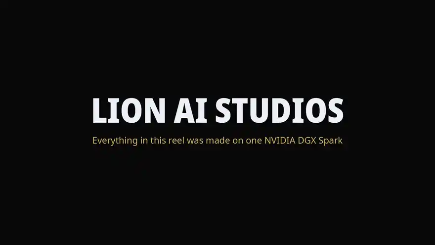</a><br>
<sub>▶ <a href="samples/video/showcase-reel-59s.mp4"><b>Watch the 59-second showcase reel</b></a> (MP4, 720p, with sound): stills, video with its own sound, a three-person scene in Cast mode with synthetic voices, an edit before/after and an explainer. Everything in it was made with this repo on one DGX Spark; more in <a href="#samples">Samples</a>.</sub></p>

## Quick start

```bash
git clone https://github.com/sunnychase/lion-ai-studios.git && cd lion-ai-studios
cp studio.env.example studio.env            # edit paths, ports and the director's address
./scripts/install_comfyui.sh                # ComfyUI at the tested commit, its venv, and the studio's image node
python3 scripts/download_models.py          # core models, ~122 GB (--list to see everything, --all for ~373 GB)
./scripts/setup_envs.sh                     # optional: voice + MIDI helper environments
./scripts/install_services.sh               # systemd --user units; open http://127.0.0.1:8482
```

Then set up the director ([docs/DIRECTOR.md](docs/DIRECTOR.md)) and, optionally, the TensorFold engine
([tensorfold/README.md](tensorfold/README.md)), Ming-Image ([docs/MING.md](docs/MING.md)) and the Fast image engine
([docs/FAST_IMAGES.md](docs/FAST_IMAGES.md)). The web app itself is a single Python file that uses only the standard
library. It starts ComfyUI when the first render needs it.

PyTorch may warn that the GB10 (compute capability 12.1) is newer than the range it was built for (up to 12.0). That warning
is harmless; everything here was tested with it.

**Which models do I need?** See [docs/MODELS.md](docs/MODELS.md). Every file has its exact Hugging Face source, size,
destination folder and licence. Short version:

| You want | Download | Size |
|---|---|---:|
| Video with sound, all presets | `--group video` core files: MiniMax H3 int8, FastH3 int8, H3 Turbo LoRA, text encoder, video + audio decoders | 67 GB |
| Images | Z-Image-Turbo and Qwen-Image 2.1 Turbo (core); nine more models are optional | 45 GB core / 180 GB all |
| Music | ACE-Step 1.5 Turbo (core); MiniMax Music 3 and the MIDI soundfont are optional | 10 / 22 GB |
| Voices | Qwen3-TTS 1.7B Base + Whisper large-v3-turbo | 6 GB |
| Cast / Recreate | MiniMax H3 reference-to-video int8 | 21 GB |
| TensorFold engine | FastH3 bf16 | 44 GB |
| Director | Qwen3.8-27B, 4-bit (via its own recipe) | ~20 GB |
| Ming-Image 0.1 Design (optional) | `inclusionAI/Ming-Image-0.1-Design` + the official code and its own venv ([docs/MING.md](docs/MING.md)) | 53 GB |

### Requirements

| | |
|---|---|
| **Hardware** | NVIDIA **DGX Spark** (GB10 Grace Blackwell, **128 GB unified memory**, aarch64). Video uses ~55 GB while rendering; the director needs ~19 GB more. Other GB10 machines with 128 GB should work but are untested. |
| **OS** | DGX OS / Ubuntu 24.04, NVIDIA driver 580+, CUDA 13.0 |
| **Disk** | ~150 GB for the core models, ~360 GB for everything, plus room for your library. Use the internal NVMe: models must not run off network storage. |
| **Software** | Python 3.12, `ffmpeg` 6.x or newer (tested 6.1.1, the Ubuntu 24.04 / DGX OS package; 4.4 pads Faithful shots short), `git`, `curl`; Docker only for the TensorFold director recipe; [Deno](https://deno.com) (optional, recommended) as yt-dlp's JavaScript runtime, which YouTube downloads now need (`DENO_BIN` or `deno` on PATH) |
| **Renderer** | ComfyUI pinned to commit `b26625f2` (v0.39.0 + 18), PyTorch 2.10 + cu130 |

### Configuration

Everything machine-specific lives in `studio.env` ([template](studio.env.example)): paths, ports, the ComfyUI address,
the director's address and model name, the thermal guard (pause at 95 °C, resume below 85 °C), and an optional
*GPU tenant*. That is another service, such as a vLLM server, that the studio may stop before rendering and offer to start again
afterwards. It always asks you first. The optional Ming-Image model and the optional Fast image engine (LocalRouter, off by
default) are configured there too.

**Remote access.** The app listens on `127.0.0.1` and has no login. To use it from your phone, put it behind an
authenticating reverse proxy or tunnel (for example Cloudflare Access, Tailscale, or nginx with auth). Never expose it bare.

## How it works

```
 browser (desktop or phone)
        │  http://127.0.0.1:8482
        ▼
 studio server ── app/studio_server.py: one Python file, standard library only; the page, the queue, the library
        │
        ├── ComfyUI ............ renders video with sound (MiniMax H3 / FastH3), the image models and music
        ├── the director ....... a vision-language model behind an OpenAI-compatible API: writes, reviews, arranges
        └── helper runners ..... voices (Qwen3-TTS, Whisper, Demucs), MIDI, and the optional Ming-Image and Fast (LocalRouter) engines
                                  all on one DGX Spark
```

The studio server keeps one queue and runs the oldest job first, one at a time. It starts ComfyUI when the first render
needs it, waits for enough free memory before loading models, and pauses between segments when the board gets hot.
Each helper runs in its own Python environment, so the server itself needs nothing beyond the standard library.
Everything machine-specific comes from `studio.env` through `app/config.py`.

## What you can make

| Builder | What you get |
|---|---|
| **Video** | **MiniMax H3** makes picture and sound together. Start from text, from scout images, from your own first frame, or from several keyframes that become one film. Films up to **5 minutes** are chained from 15 s segments; every seam carries the previous segment's last frames *and* audio, so cuts are invisible. Four presets: Draft, **Fast HD** (default), Standard, High. |
| **Image** | Twelve image models behind one menu: **FLUX 3 Image Klein** (new: Black Forest Labs' 5.6B model with its own prompt upsampler), Z-Image-Turbo, Qwen-Image 2.1 Turbo (2K, best at text), Krea 2, FLUX.2 klein, HiDream-O1, Chroma and more. **Edit** any image by describing the change (Qwen-Image 2.1 Turbo or FLUX 3 Image Klein, up to 4 input images). Optional **Ming-Image 0.1 Design** for posters, UI screens and infographics, with a transparent-background option: the director lays out the design with Ming's own rewriter first ([setup](docs/MING.md)). Optional **Fast** engine: Qwen-Image 2.1 Turbo through [LocalRouter](https://github.com/jayleaton/localrouter) at 1024×1024, about 6 s instead of 9 s warm, falling back to ComfyUI on its own ([setup](docs/FAST_IMAGES.md)). |
| **Music** | **Fast**: ACE-Step 1.5 Turbo, a minute of music in seconds, with lyrics. **Best**: MiniMax Music 3. **MIDI**: attach a `.mid`, pick an instrument for every part (all 128 General MIDI instruments and 8 drum kits), or describe the sound you want ("jazz trio with brushed drums") and let the **director arrange it**: it picks an instrument or kit for every part, mutes what does not fit, and turns on the AI restyle when instruments alone cannot get there. |
| **Director** | A vision-language model (Qwen3.8-27B) turns one sentence into a shot prompt with one beat per segment, **watches every rendered segment**, scores it, and re-takes a weak one once. It also picks out the performer in a Short, checks every frame Recreate swaps, and arranges MIDI files from a description. |
| **Voices** | Clone a voice from a short clip (Qwen3-TTS) for narration or on-camera lines, from the Voices tab or right inside the Video builder's voice-over section. Clone **everyone who speaks** in one video at once ([below](#voices-several-people-from-one-video)). Whisper listens to every spoken take and re-draws one that drops or adds words. Optional **Fish Audio Drama 3** engine for the most natural narration ([below](#fish-audio-drama-3-optional)). |
| **Cast** | Put the person from up to 3 reference photos into the video (H3 reference-to-video, the official recipe). Consent checkbox required. |
| **Recreate a Short** | Paste a YouTube Short and recast it. **Faithful** (default) follows the original frame by frame: the director picks out the performer and checks anchor frames about 1.2 s apart inside every shot; only where the performer's face is visible is your cast swapped in (from one clean portrait, never from an earlier swap), and H3 animates between the anchors, each clip retimed to the exact gap. **Re-imagine** has the director re-describe each shot and re-shoots it with your cast, optionally with your changes. The output keeps the Short's shape (vertical stays vertical) unless you pick landscape. **Soundtrack:** the original audio exactly (default), the original music under your cast's voices, or new sound made with the picture. With the original sound, every shot is cut to the original's length so the cuts land on the beat. |
| **Editor** | Re-take any segment, re-score the film, and export with crossfaded seams. |
| **Library / Queue** | Everything you make, filterable, with a download button on every video, song and image. Renders keep going if you close the page. Deleting moves a render or voice to the **Trash** (Library → Trash), where you can restore it or delete it for good. |

A **TensorFold** int8 engine for FastH3 is optional and makes Draft **1.7–1.9x** and Fast HD **1.4x** faster ([benchmarks](docs/BENCHMARKS.md)).

**Checks and guards** (new 2026-10-16):
- **Negation warning.** The video and image models have no negative prompt, so "no cars" tends to bring cars. The page flags such
  phrases under the prompt as you type and suggests saying what *is* there; the studio's own prompts and the director are written that way.
- **Shot check.** Every rendered clip is frame-checked: a hard cut inside a clip asked for as one shot, or a keyframe film clip that does
  not open or close on its pictures, triggers the same single re-take as a weak director score.
- **Edit noise seed.** An image edit draws its noise from the seed *and* the input pictures, so an edit with the seed its source was
  made with no longer walks back to the source.
- **Memory guard.** While a render runs, free memory is read 4 times a second; below 6 GiB the render is stopped with a clear message,
  below 3 GiB ComfyUI is stopped too, so the Spark never freezes (`STUDIO_MEM_FLOOR_GIB`, `STUDIO_MEM_CRIT_GIB`).

### Voices: several people from one video

On the Voices tab, tick **Clone everyone who speaks** and paste a YouTube Short (or video). The studio transcribes it, fingerprints
each phrase with Qwen3-TTS's own speaker encoder, groups the phrases by voice and makes one voice per person (up to 6). Each
person's reference is their longest clean stretch on their own, or a few of their own turns joined when nobody talks long alone, and
it is transcribed again from that clip alone so no one else's words leak into the clone. The director looks at frames taken while
that person speaks and names the voice (a name only when the speaker names themselves). If the count comes out wrong, set **How many
people?** (2–6) instead of Auto. Each person needs about 5 s of clean speech. Consent is required, as for every clone.

### Fish Audio Drama 3 (optional)

The narrator can speak with **Fish Audio Drama 3** instead of Qwen3-TTS: Video builder → voice-over → *Voice engine*. It is slower to
start and needs the GPU free (about 42 GB at its peak), and it sounds the most natural; every take is word-checked by Whisper like
Qwen3-TTS takes. It runs on TensorFold's native CUDA port, which you build once, and the weights (41.5 GB) are opt-in:
`python3 scripts/download_models.py --group drama3`. Setup: [docs/DRAMA3.md](docs/DRAMA3.md). **Built with Fish Audio.** The weights
are under the Fish Audio Community License: free for research and non-commercial use, commercial use only under US$500,000 annual
revenue, never as a hosted voice service without Fish Audio's licence, and only with consent for real people's voices.

**Fast server (new 2026-10-16, testing):** with [drama-tensorfold](https://github.com/plotarmordev/drama-tensorfold) built, the studio
starts an on-demand loopback speech server for a Drama 3 voice-over (it needs about 88 GiB free to load), makes each cloned voice a voice
file once, speaks every line through it with the same Whisper check, and stops it when idle. On a DGX Spark the server was ready in 10 s
and a cloned 18-word line came back word-perfect in about 19 s including the check (the per-take build: about 39 s). If it fails, the
per-take build and then Qwen3-TTS take over, with the reason in the job notes. drama-tensorfold is **testing, not qualified** (not all of
its accuracy bars against the reference are met); setup and status: [docs/DRAMA3.md](docs/DRAMA3.md#fast-server-drama-tensorfold).

## Samples

All of these were made with this repo on one DGX Spark. Prompts and settings are in [samples/README.md](samples/README.md).

| | |
|---|---|
| [](samples/video/showcase-reel-59s.mp4)<br>**Showcase reel** (59 s): stills, video with sound, a three-person scene, an edit and an explainer, on a studio-made score | [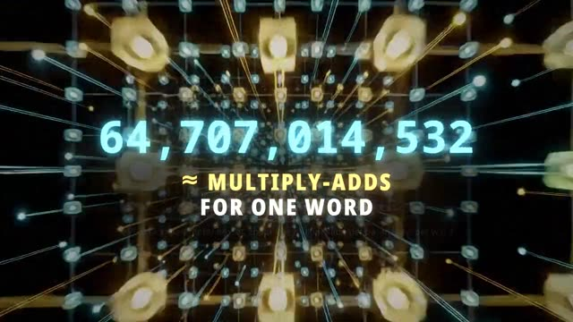](samples/video/matrix-math-explainer-62s.mp4)<br>**Matrix math explainer** (62 s): ten AI shots cut to a 128 BPM score, narrated by a synthetic voice; every number on screen is computed |
| [](samples/video/cafe-conversation-cast-3-voices-24s.mp4)<br>**Three people, one café** (24 s): Cast mode from three portraits, each speaking in their own synthetic voice; every line checked word for word | [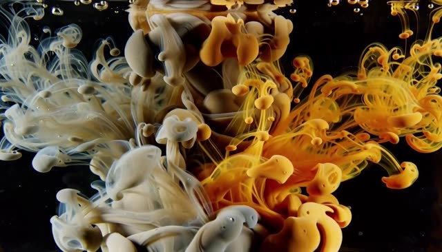](samples/video/ink-fluid-flow-fasthd-8s.mp4)<br>**Fluid flow**: 8 s Fast HD, ink vortices with sound (review 8/10) |
| <br>FLUX 3 Image Klein: motorsport | <br>FLUX 3 Image Klein: dinosaurs |
| 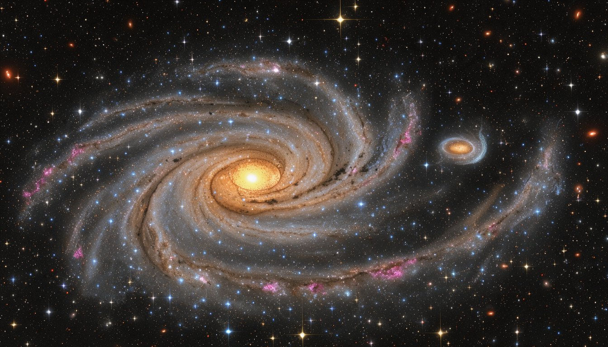<br>FLUX 3 Image Klein: a spiral galaxy | <br>Krea 2 Turbo + realism LoRA: night sky |
| <br>Krea 2 Turbo + realism LoRA: wildlife | <br>FLUX 3 Image Klein: wildlife |
| <br>FLUX 3 Image Klein: fluid dynamics | 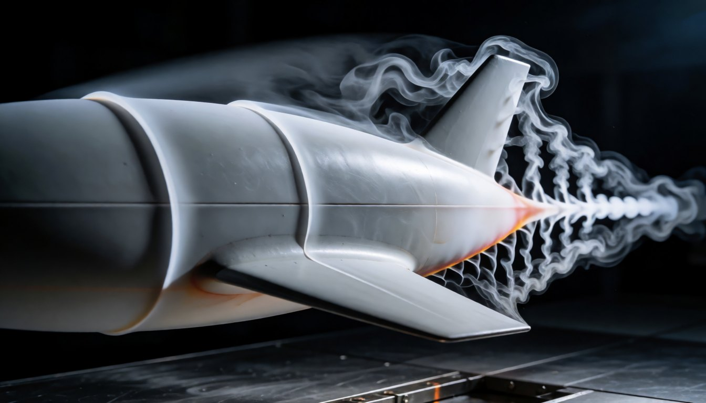<br>Krea 2 Turbo + realism LoRA: wind-tunnel smoke |
| <br>Krea 2 Turbo + realism LoRA | 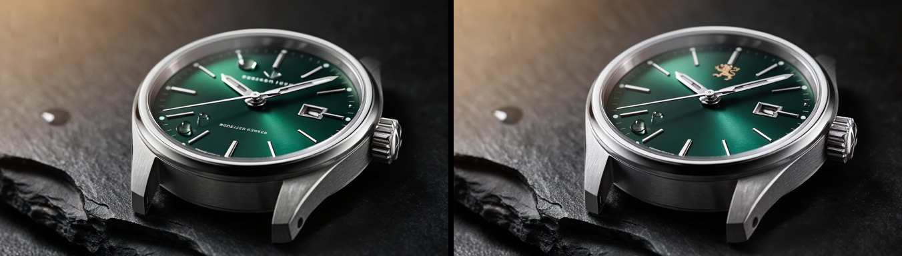<br>Edit with FLUX 3 Image Klein: "a clean dial and a small gold lion emblem" (left: the original) |
| 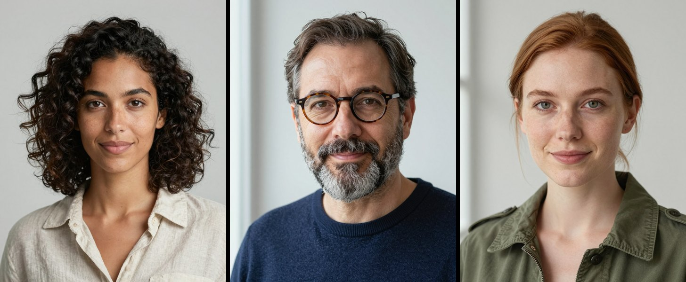<br>Z-Image-Turbo: the three portraits behind the café scene | 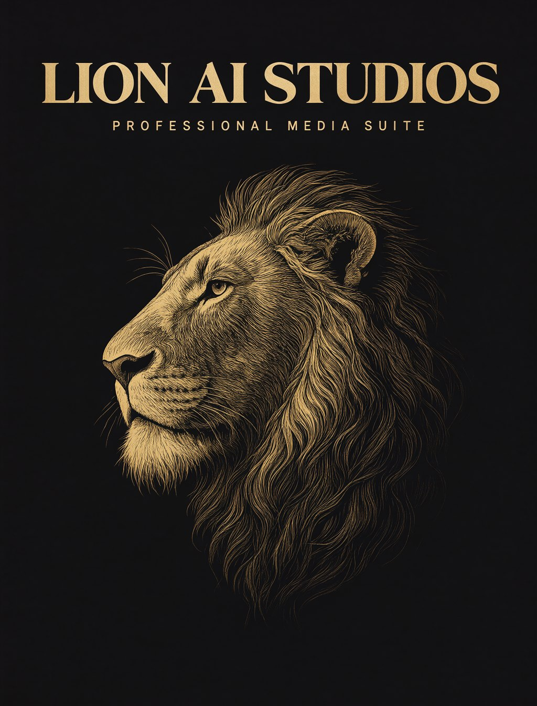<br>Qwen-Image 2.1: lettering |
| [](samples/video/lion-roar-fasthd-10s.mp4)<br>**Lion roar**: 10 s Fast HD with sound, written by the director from one sentence (review 8/10) | [](samples/video/paper-boat-film-fasthd-33s.mp4)<br>**Paper boat**: a 33 s film of 3 segments joined seamlessly, picture and sound continuous across the joins |
| 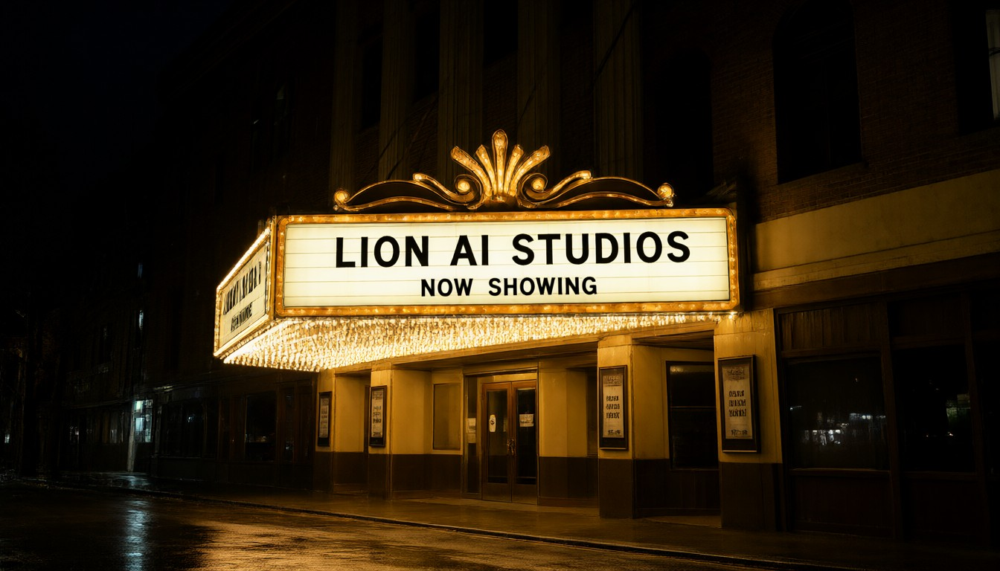<br>Qwen-Image 2.1 Turbo: text in the picture | <br>Z-Image-Turbo |
| <br>Krea 2 Turbo + realism LoRA | <br>FLUX.2 klein 4B |
| <br>FLUX 3 Image Klein, from a one-line prompt | 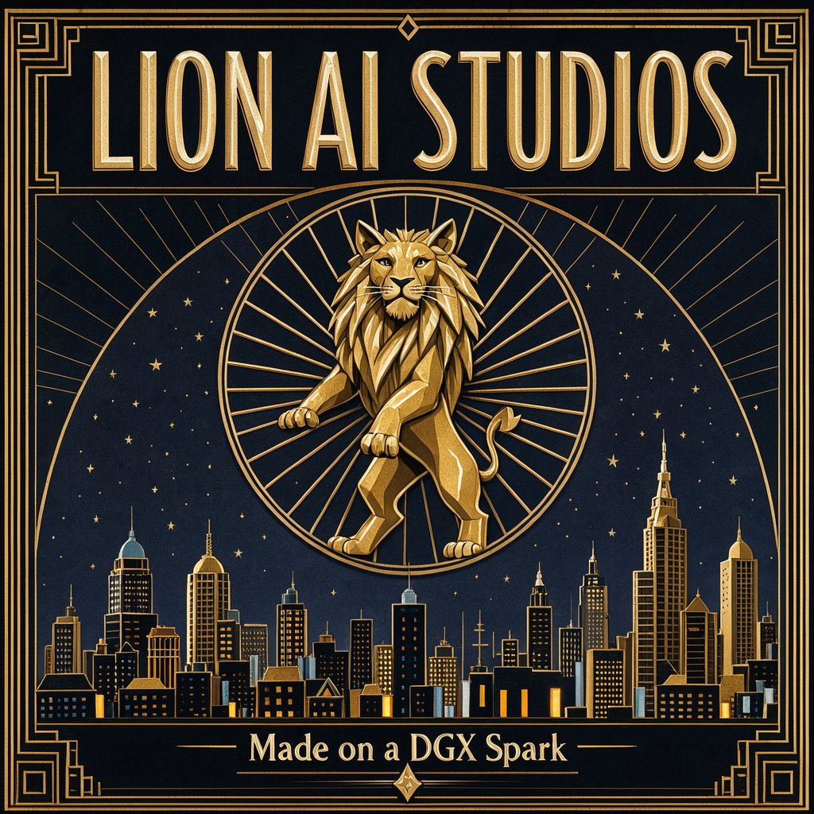<br>FLUX 3 Image Klein: lettering |
| <br>Edit with FLUX 3 Image Klein: "Make the mug glossy red ceramic with steam rising from it" | |

**Music:** [Trailer, 128 BPM](samples/music/trailer-128bpm-ace-step.mp3) and [café jazz](samples/music/cafe-jazz-ace-step-40s.mp3) (ACE-Step, used in the videos above) ·
[Run with the Lions](samples/music/run-with-the-lions-ace-step.mp3) (ACE-Step, a song with original lyrics) ·
[Trailer score](samples/music/trailer-score-minimax-music3.mp3) (MiniMax Music 3) ·
[Lion's Dawn, MIDI with chosen instruments](samples/music/lions-dawn-midi-instruments.mp3) and
[the same piece restyled by AI](samples/music/lions-dawn-midi-ai-restyle.mp3) ([the .mid](samples/music/lions-dawn.mid))

<p>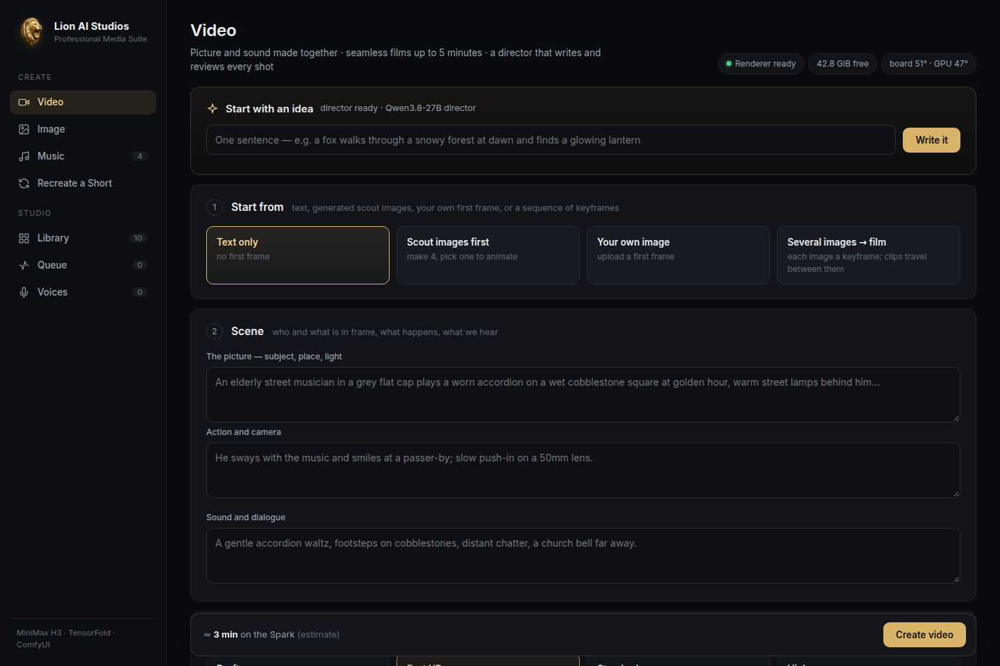</p>
<p>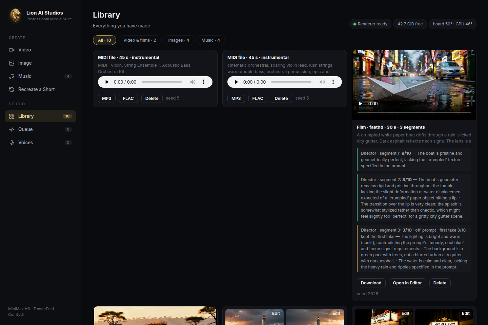 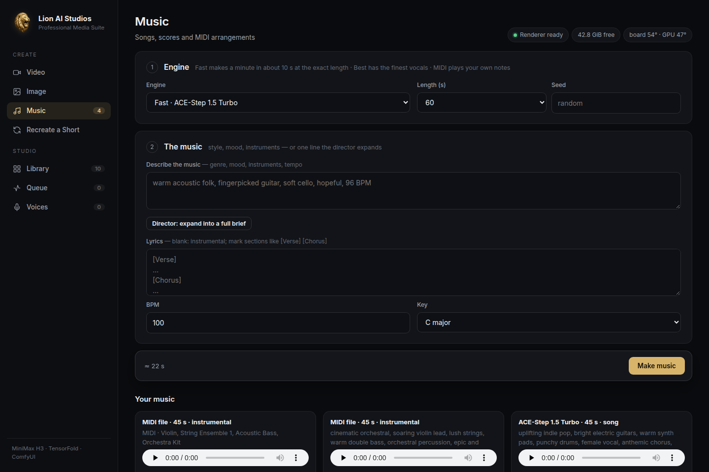</p>
<p>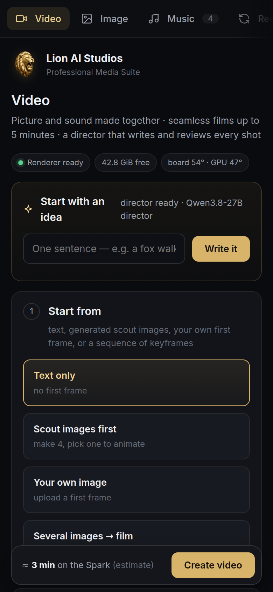 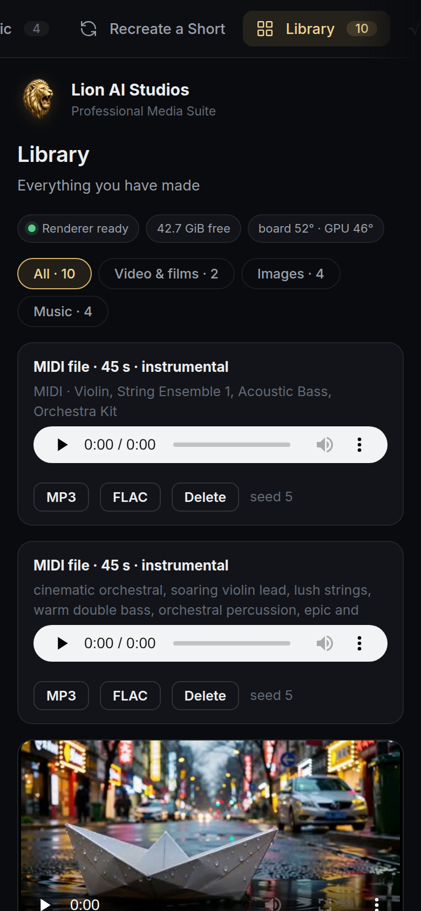 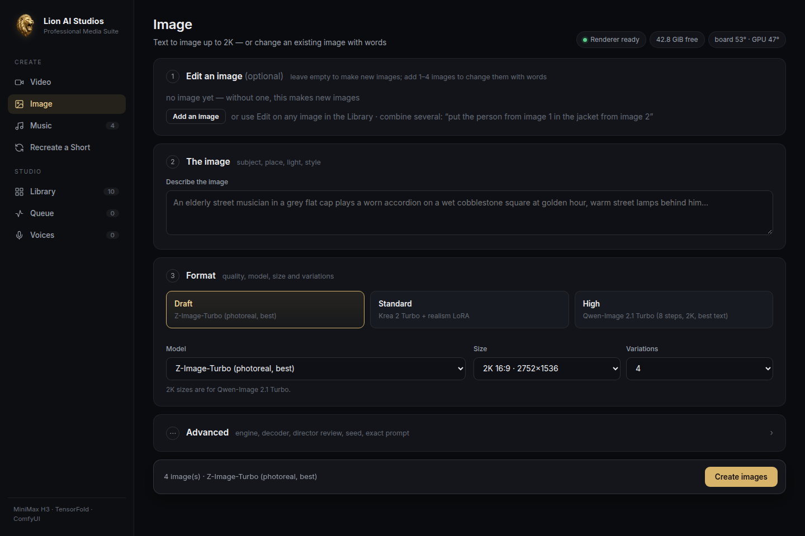</p>

## Benchmarks

One DGX Spark, 5 s clip with sound, single runs (n = 1). Details and caveats are in the full report.

| | ComfyUI | TensorFold engine |
|---|---:|---:|
| **Draft** 864x480, 8 steps | 132 s | **76 s** (1.74x) · **70 s** with the 8-bit decoder (1.89x) |
| **Fast HD** 1344x768, 8 steps | 272 s | **192 s** (1.42x) |
| **Standard** H3 + Turbo, 8 steps | 332–415 s | not shipped (dense path tested: 5–8 % faster, [§4](docs/BENCHMARKS.md#4-standard-and-high-on-tensorfold-experimental-vs-fast-hd)) |
| **High** H3 base 1344x768, 20 steps | 1052 s | not shipped (dense path tested: 5–8 % faster, [§4](docs/BENCHMARKS.md#4-standard-and-high-on-tensorfold-experimental-vs-fast-hd)) |

| Other | Time |
|---|---:|
| 20 s Draft film (2 segments, seamless) through the studio | 373 s |
| Qwen-Image 2.1 Turbo, 1344x768 / 2752x1536 | 10 s warm, 20 s cold / 44 s |
| Other image models, 1344x768, warm: FLUX.2 klein · Z-Image Turbo · Krea 2 · Qwen-Image 2.1 · HiDream-O1 · Chroma1-HD | 4 · 8 · 16 · 18–20 · 26–28 · 56–58 s (n = 2 each; [all models](docs/BENCHMARKS.md#10-all-image-models-2026-10-12)) |
| Image edit (Qwen-Image 2.1 Turbo), 1 / 2 / 4 references, warm | 16 / 24 / 40 s ([details](docs/BENCHMARKS.md#11-image-edit-1-2-and-4-references)) |
| FLUX 3 Image Klein, prompt upsampler included: 1344x768 cold / 1024x1024 / 832x1216; edit with 1 / 2 references | 28.7 s / 20.7–22.6 s / 21.6 s; 35.0 / 59.0 s (n = 1 each; [details](docs/BENCHMARKS.md#15-flux-3-image-klein-2026-10-15)) |
| Ming-Image 0.1 Design, 1024x1024 | ~5.5 min per job (4.6 min of it loading), +22 s per extra image |
| Voice clone from a 5 s clip / ~30 s narration (Qwen3-TTS) | 67 s / 56 s, i.e. 0.59x realtime (1.3x with the model loaded) |
| Fish Audio Drama 3, a cloned 18-word line incl. the Whisper check: fast server (drama-tensorfold) / per-take build | ~19 s (server ready in 10 s) / ~39 s (n = 1) |
| Cast (reference to video, official 20 steps), 5 s: Draft 480p / Fast HD | 328 s / 979 s |
| Qwen-Image 2.1 Turbo, 1024x1024, warm: ComfyUI / Fast (LocalRouter) | 9.3 s / 6.2 s (n = 12 each; [details](docs/FAST_IMAGES.md#measured)) |
| ACE-Step 1.5 Turbo, 30–60 s of music | 4–16 s (3.8–7.5x realtime) |
| MiniMax Music 3 | ~0.46x realtime |

On the same two prompts, the director scored **Fast HD 8/8** against **Standard 5/9**. Fast HD is also 1.6–1.7x faster and
renders at a higher resolution, which is why it is the default preset.

Full tables, methods and limitations are in [docs/BENCHMARKS.md](docs/BENCHMARKS.md), and the raw results and scripts are in [benchmarks/](benchmarks/).

## FAQ

<details>
<summary><b>Does anything leave my machine?</b></summary>

Rendering, the director, voices and music all run on the Spark, and the app listens on `127.0.0.1` only. The internet is
used to download models, to fetch a YouTube Short when you paste one into *Recreate a Short* or the voice cloner, and by the
page to load the Inter font from Google Fonts. No cloud API is called.
</details>

<details>
<summary><b>Which hardware do I need?</b></summary>

An NVIDIA DGX Spark (GB10, 128 GB unified memory). Video uses about 55 GB while rendering and the director about 19 GB more.
Other GB10 machines with 128 GB should work but are untested. See [Requirements](#requirements).
</details>

<details>
<summary><b>How long do renders take?</b></summary>

On one Spark, a 5 s clip with sound takes 132 s at Draft (76 s with the TensorFold engine) and 272 s at Fast HD (192 s). A
Qwen-Image 2.1 Turbo image takes 16 s at 1344x768, and ACE-Step makes 30–60 s of music in 4–16 s. All numbers and their
caveats are in [docs/BENCHMARKS.md](docs/BENCHMARKS.md).
</details>

<details>
<summary><b>Can I run it without ComfyUI?</b></summary>

No. ComfyUI renders the video, the image models and the music. Voices, MIDI, Ming-Image and the optional Fast image engine run
beside it in their own environments, but the studio is built around ComfyUI and starts it on the first render.
</details>

<details>
<summary><b>Do I need the director?</b></summary>

Not to render. Without it the studio still makes video, images and music; *Write it*, reviews, music briefs, MIDI arranging,
*Recreate a Short* and Ming-Image's layout step need it. Setup: [docs/DIRECTOR.md](docs/DIRECTOR.md).
</details>

<details>
<summary><b>Can I use what I make commercially?</b></summary>

The code here is MIT, but every model keeps its own licence, and several restrict commercial use (among them Qwen-Image 2.1,
Juggernaut Z, Krea 2 and MiniMax H3, and the optional Fish Audio Drama 3 voice engine). Check [docs/MODELS.md](docs/MODELS.md) before you sell or publish.
</details>

<details>
<summary><b>Can I use it from my phone?</b></summary>

Yes, the page works on a phone, but the app has no login. Put it behind an authenticating reverse proxy or tunnel (for
example Cloudflare Access, Tailscale, or nginx with auth). Never expose it bare.
</details>

<details>
<summary><b>Is it safe to clone voices and recast people?</b></summary>

Only with consent. Cast, Recreate and the voice cloner ask you to confirm you have the right to use the person's likeness or
voice. Read [docs/RESPONSIBLE_USE.md](docs/RESPONSIBLE_USE.md).
</details>

## Documentation

| | |
|---|---|
| [docs/MODELS.md](docs/MODELS.md) | every model: source, size, destination folder, licence |
| [docs/DIRECTOR.md](docs/DIRECTOR.md) | setting up the director (TensorFold recipe or any OpenAI-compatible server) |
| [docs/MING.md](docs/MING.md) | the optional Ming-Image 0.1 Design model: weights, code and venv |
| [docs/FAST_IMAGES.md](docs/FAST_IMAGES.md) | the optional Fast image engine (LocalRouter) and the memory broker |
| [docs/DRAMA3.md](docs/DRAMA3.md) | the optional Fish Audio Drama 3 voice engine: licence, weights, the drama-tensorfold fast server, building the TensorFold engine on a Spark |
| [tensorfold/README.md](tensorfold/README.md) | the optional TensorFold engine for FastH3 |
| [docs/BENCHMARKS.md](docs/BENCHMARKS.md) | full benchmark tables, methods and limitations ([raw results](benchmarks/)) |
| [docs/RESPONSIBLE_USE.md](docs/RESPONSIBLE_USE.md) | consent, copyright and labelling |
| [samples/README.md](samples/README.md) | the prompts and settings behind every sample |
| [studio.env.example](studio.env.example) | every setting, with comments |
| [CHANGELOG.md](CHANGELOG.md) | what changed in each update |
| [NOTICE.md](NOTICE.md) | third-party software, models and fonts |
| [CONTRIBUTING.md](CONTRIBUTING.md) · [AGENTS.md](AGENTS.md) · [SECURITY.md](SECURITY.md) | development, checks, notes for coding agents, private security reports |

## Repository

```
app/               the studio: web server (stdlib only), ComfyUI graphs, director, music, MIDI, voice and Ming-Image workers, the page
comfyui_nodes/     Lion AI Studios image node for ComfyUI (one menu for eleven image models)
tensorfold/        optional TensorFold engine: setup notes + a small patch
scripts/           install ComfyUI, download models, helper envs, systemd units, the repository checks (check.sh)
systemd/           unit templates (studio, ComfyUI, optional director, optional LocalRouter and Drama 3 server examples)
docs/              models, director, Ming-Image, Fast images, benchmarks, responsible use, screenshots
benchmarks/        raw results and the scripts that produced them
samples/           example videos, images and music made with the studio
CHANGELOG.md       what changed in each update
```

## Responsible use

Voice cloning, Cast and Recreate can be misused. Use them only with people who have consented, respect copyright, and
label AI-generated media. Read [docs/RESPONSIBLE_USE.md](docs/RESPONSIBLE_USE.md).

## Contributing

Bug reports and focused pull requests are welcome: [open an issue](https://github.com/sunnychase/lion-ai-studios/issues) or
[send a pull request](https://github.com/sunnychase/lion-ai-studios/pulls). Keep machine-specific settings in `studio.env`
(read through `app/config.py`), never in the code. [CONTRIBUTING.md](CONTRIBUTING.md) covers running a development copy and the
checks (`bash scripts/check.sh`); [AGENTS.md](AGENTS.md) is a short guide for coding agents. Report security problems privately,
as described in [SECURITY.md](SECURITY.md).

## Star history

<a href="https://www.star-history.com/#sunnychase/lion-ai-studios&Date">
  <picture>
    <source media="(prefers-color-scheme: dark)" srcset="https://api.star-history.com/svg?repos=sunnychase/lion-ai-studios&type=Date&theme=dark">
    <source media="(prefers-color-scheme: light)" srcset="https://api.star-history.com/svg?repos=sunnychase/lion-ai-studios&type=Date">
    
  </picture>
</a>

## License

Created by **[Sunny Chase](https://github.com/sunnychase)** in collaboration with **Claude** (Anthropic).

The code in this repository is under the [MIT licence](LICENSE). It builds on ComfyUI, MiniMax H3 and Music 3, FastVideo's
FastH3, Qwen, ACE-Step, TensorFold and many open models; see [NOTICE.md](NOTICE.md). Each model keeps its own licence, and
several restrict commercial use.
